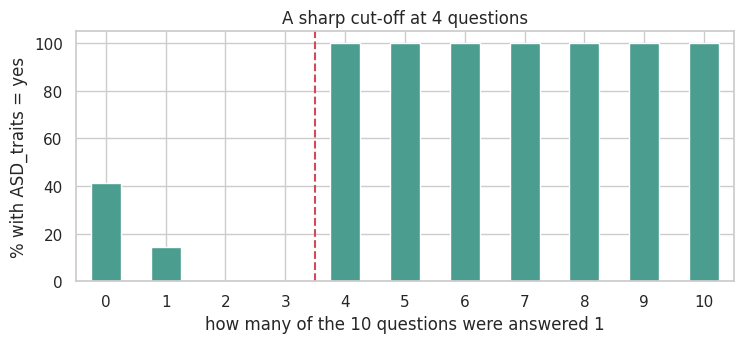
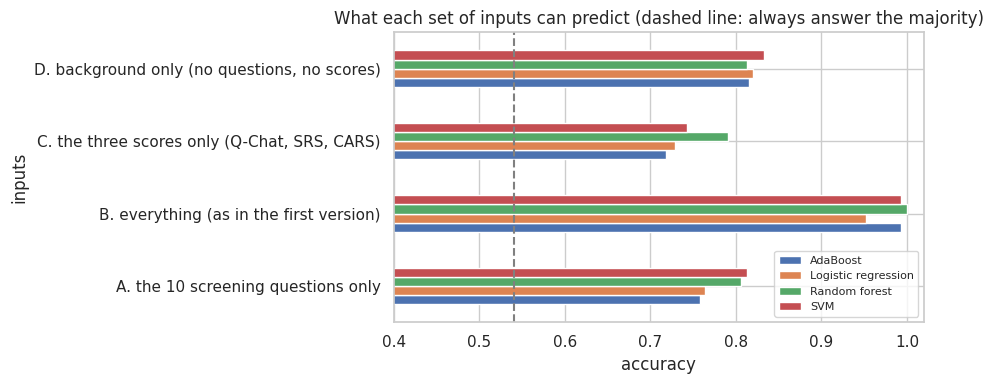
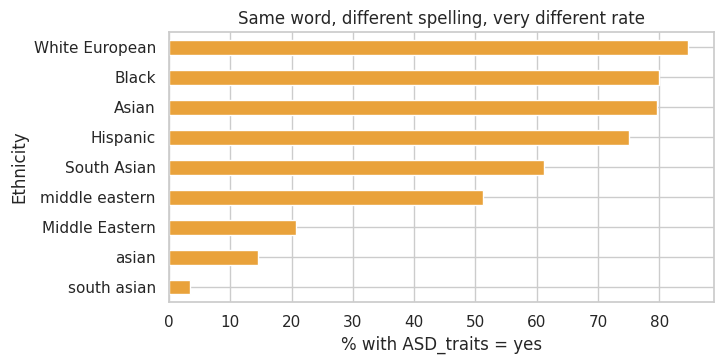

# Autism traits prediction: what is the model really using?

An exercise in evaluating a model honestly. The task: predict `ASD_traits` (yes / no) from a screening dataset of 1,985 children with
logistic regression, AdaBoost, SVM and Random Forest, and find out **what the models are actually using** to do it.

> **This is a screening dataset, not a diagnosis.** Nothing in this repository is medical advice or a clinical tool.

## Main finding

The first version of this project reported 100 % accuracy. That number is not a finding:

- The label `ASD_traits` is, for the 912 children with 2 or more positive answers, **exactly** the cut-off of the questionnaire in the
  data ("4 or more of the 10 questions answered 1"). The inputs of the first version included those questions.
- Even **without any questionnaire or score**, the models reach 0.81 to 0.83 (always answering "yes" gives 0.54), but most of that comes
  from the **spelling of the ethnicity column**, which identifies where a row came from.



## What each set of inputs can predict

Five-fold cross-validation **grouped by child** (a repeated row never sits on both sides). Accuracy:

| Inputs | Logistic regression | AdaBoost | SVM | Random forest |
|---|---:|---:|---:|---:|
| A. the 10 screening questions only | 0.764 | 0.758 | 0.814 | 0.806 |
| **B. everything (as in the first version)** | 0.952 | 0.993 | 0.993 | **1.000** |
| C. the three scores only (Q-Chat, SRS, CARS) | 0.729 | 0.719 | 0.743 | 0.791 |
| D. background only (no questions, no scores) | 0.820 | 0.816 | 0.833 | 0.813 |



## The file was assembled from several sources

- **One third of the rows are repeats:** 1,985 rows but only 1,329 different children.
- **The spelling of a word carries information.** The share of `yes` is 80 % for `Asian` and 15 % for `asian`, 61 % for `South Asian` and
  3 % for `south asian`. These are different sources, not different populations.
- **Seven condition columns are almost the same column** (speech delay, learning disorder, genetic disorders, depression, developmental
  delay, social/behavioural issues, anxiety): in 96 % of the rows all seven agree.
- **Even the row order relates to the label:** the share of `yes` falls from 58-75 % in the first three fifths of the file to 35-38 % in the last two.



### Where does the "background only" result come from?

| Background variables | Logistic regression | Random forest |
|---|---:|---:|
| all background | 0.820 | 0.813 |
| without ethnicity | 0.638 | 0.635 |
| without the 7 near-identical flags | 0.814 | 0.781 |
| without ethnicity and without the flags | 0.654 | 0.617 |

Removing the ethnicity column drops the accuracy from about 0.82 to 0.64. Some genuine association remains (sex and family history, for
example), but most of the apparent signal comes from how the file was put together.

### What do the repeated rows cost?

For the scores-only model: 0.872 with random folds against 0.791 when grouped by child, so 8 points came from memorised rows. For the
other input sets there is no measurable difference, but grouping costs nothing and is the safe default.

## What I changed from my first version

The first version of this project (bootcamp final project) had these problems:

- The inputs included the **questionnaire that defines the label** (`A1` to `A10` and the Q-Chat score), and the 100 % accuracy was reported as a result.
- The test set was **5 % of the data** (about 100 children), one single split.
- Categories were converted with a label encoder over the raw text, so every **spelling** was its own category and the model could learn the source.
- One third of the rows were repeats and could fall on both sides of the split.

This version keeps the four models, groups the cross-validation by child, tests four sets of inputs, and investigates why the scores are
so high.

## Limitations

- A screening dataset with unclear provenance, not a clinical study.
- Removing inputs and grouping reduces the problems but cannot prove that every source artefact has been found.
- Ethnicity is analysed here only as a data-quality signal, never as a predictor to use.

**Next steps:** repeat the exercise on a documented public screening dataset with known provenance, evaluate by source (train on some
sources, test on another) and report separately the children with 0 or 1 positive answers, the only group where the label is not defined
by the questionnaire.

## Run it

```bash
pip install -r requirements.txt
# put data_csv.csv in data/  (see data/README.md)
jupyter notebook autism_traits_prediction.ipynb
```
